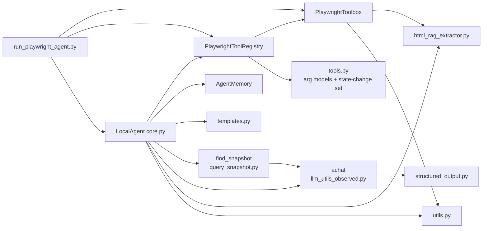
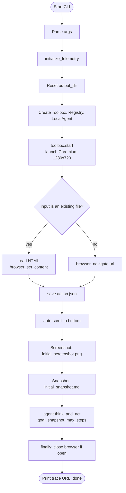
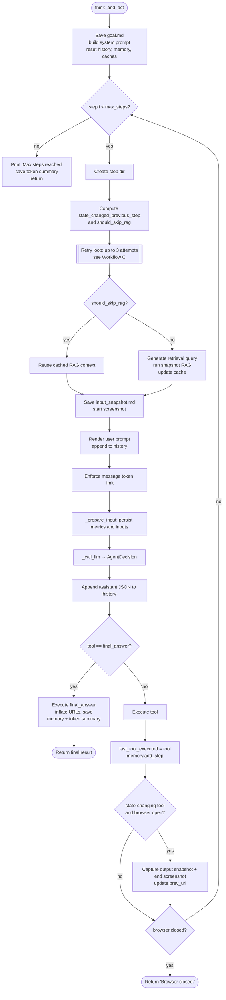
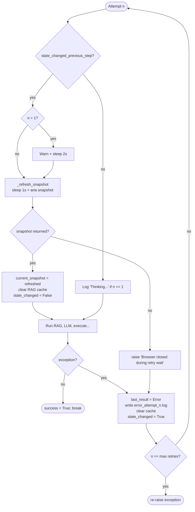
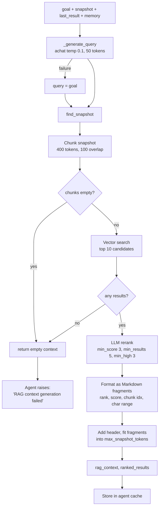
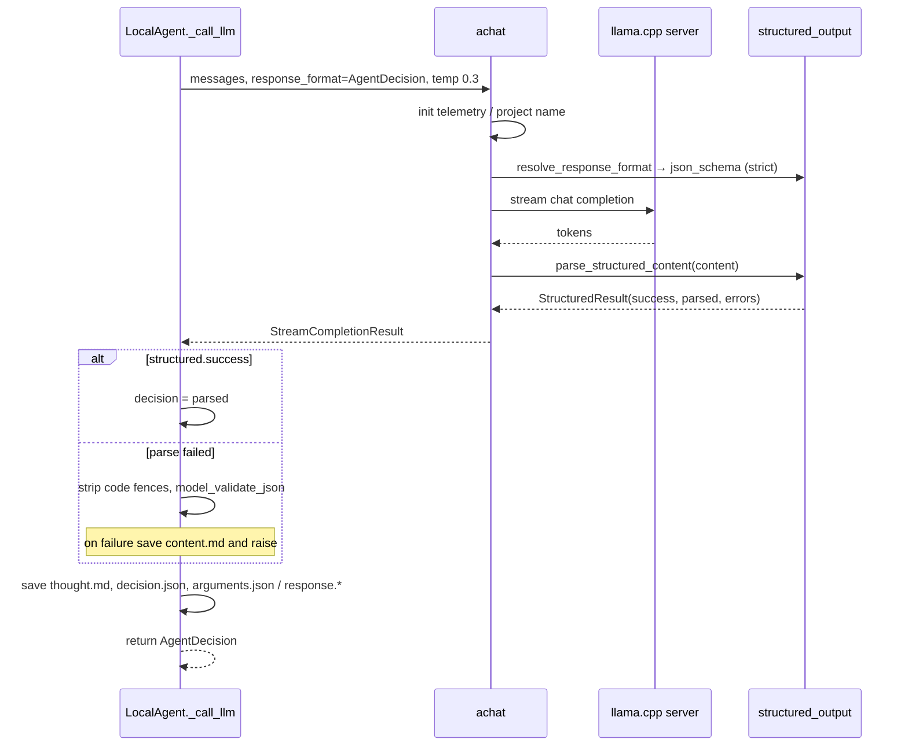
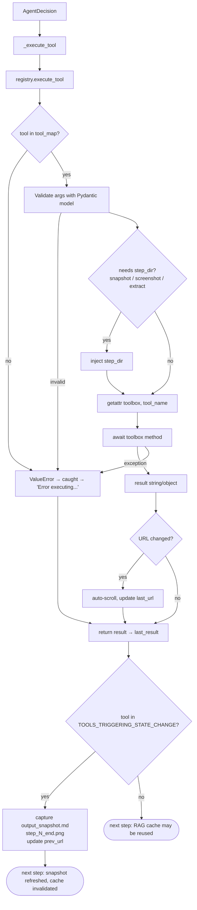
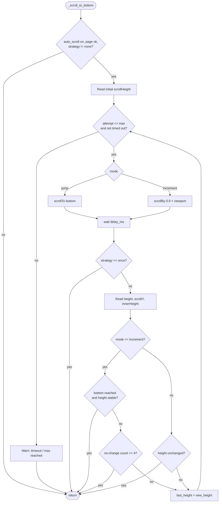
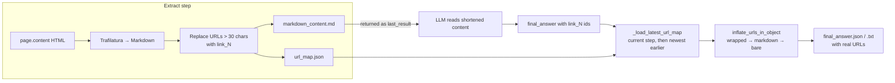
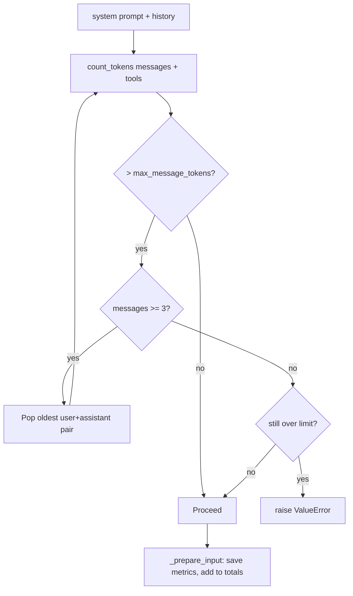

# Browser Agent Workflows

Step-by-step analysis of `jet/scrapers/browser/agent/*` and the modules it depends on, as driven by `run_playwright_agent.py`.

## Table of Contents

1. [Module Map](#1-module-map)
2. [Workflow A: Startup and Entry Point](#2-workflow-a-startup-and-entry-point)
3. [Workflow B: Main Agent Loop](#3-workflow-b-main-agent-loop-think_and_act)
4. [Workflow C: Retry and State-Refresh Logic](#4-workflow-c-retry-and-state-refresh-logic)
5. [Workflow D: Snapshot RAG Pipeline](#5-workflow-d-snapshot-rag-pipeline)
6. [Workflow E: LLM Decision Call](#6-workflow-e-llm-decision-call)
7. [Workflow F: Tool Execution](#7-workflow-f-tool-execution)
8. [Workflow G: Auto-Scroll](#8-workflow-g-auto-scroll)
9. [Workflow H: Final Answer and URL Inflation](#9-workflow-h-final-answer-and-url-inflation)
10. [Workflow I: Memory and Token Management](#10-workflow-i-memory-and-token-management)
11. [Output Directory Layout](#11-output-directory-layout)
12. [Termination Conditions](#12-termination-conditions)
13. [Observations and Potential Issues](#13-observations-and-potential-issues)

---

## 1. Module Map

| Module                                          | Role                                                                            |
| ----------------------------------------------- | ------------------------------------------------------------------------------- |
| `run_playwright_agent.py`                       | CLI entry point; wires components; performs step 0 (initial load)               |
| `agent/core.py` (`LocalAgent`)                  | Orchestrator: the think → act loop, retries, caching, persistence               |
| `agent/toolbox.py` (`PlaywrightToolbox`)        | Low-level Playwright actions (navigate, click, type, scroll, snapshot, extract) |
| `agent/registry.py` (`PlaywrightToolRegistry`)  | Validates tool arguments and dispatches to toolbox methods                      |
| `agent/tools.py`                                | Pydantic argument models, `AgentDecision`, `TOOLS_TRIGGERING_STATE_CHANGE`      |
| `agent/templates.py`                            | System and user prompt templates                                                |
| `agent/memory.py` (`AgentMemory`)               | Short-term working memory (recent steps, URLs, findings)                        |
| `agent/utils.py`                                | `get_step_dir`, `save_json`, `save_text`, rich links                            |
| `rag_utils/query_snapshot.py` (`find_snapshot`) | Chunk → vector search → LLM rerank of the page snapshot                         |
| `llm_utils_observed.py` (`achat`)               | Async LLM call with telemetry, streaming, structured output                     |
| `structured_output.py`                          | Resolves `response_format` and validates output                                 |
| `html_rag_extractor.py`                         | Trafilatura extraction, URL shortening (`link_N`) and inflation                 |



---

## 2. Workflow A: Startup and Entry Point

`main()` (decorated with `@chain("playwright-agent-entry")`) does the following:

1. Parse CLI args (`url_or_file`, `--headless`, `--goal`, `--max-steps` default 15, `--output-dir`, `--api-base`, `--model`, `--max-message-tokens` 12000, `--max-snapshot-tokens` 3500, and the scroll options).
2. `initialize_telemetry("playwright-agent")` and print the Phoenix trace URL if available.
3. Wipe and recreate `output_dir` (`shutil.rmtree` then `mkdir`).
4. Build `PlaywrightToolbox` → `PlaywrightToolRegistry(toolbox)` → `LocalAgent(...)`.
5. `toolbox.start()`: launch Chromium (viewport 1280×720, action timeout 10 s, navigation timeout 15 s).
6. **Step 0** (initial page load):
   - If the input is an existing file: read HTML, `browser_set_content`, write `action.json` (`set_content`).
   - Otherwise: `browser_navigate(url)`, write `action.json` (`navigate`).
   - Both paths update `last_url` and run `_scroll_to_bottom()`.
   - Take `initial_screenshot.png` and `initial_snapshot.md` in `steps/step_0/`.
7. `agent.think_and_act(goal, initial_snapshot, max_steps)`.
8. `finally`: close the browser if still open. Print the final trace link.



---

## 3. Workflow B: Main Agent Loop (`think_and_act`)

### Initialization (once)

1. Save `goal.md`.
2. Build the tool schema list (`registry.get_tool_schema()`) and render the system prompt from `SYSTEM_PROMPT_TEMPLATE` with tool descriptions as JSON.
3. Reset: `history`, token counters, `memory`, `last_tool_executed`, and all `cached_*` fields.
4. `last_result = "None"`, `current_snapshot = initial_snapshot`, `prev_url = current page URL`, `response_format = AgentDecision`.

### Per step (`for i in range(max_steps)`)

| #   | Action                                                                                                                  |
| --- | ----------------------------------------------------------------------------------------------------------------------- |
| 1   | Create `steps/step_N/`.                                                                                                 |
| 2   | Compute `state_changed_previous_step = last_tool_executed in TOOLS_TRIGGERING_STATE_CHANGE`.                            |
| 3   | Compute `should_skip_rag = not state_changed_previous_step and cached_context_for_llm is not None`.                     |
| 4   | Enter the retry loop (up to `max_retries_per_step` = 3). See Workflow C.                                                |
| 5   | If state changed: refresh snapshot, invalidate cache.                                                                   |
| 6   | Either reuse the cached RAG context, or generate a query and run the RAG pipeline (Workflow D).                         |
| 7   | Save `input_snapshot.md`, take `step_N_start.png`.                                                                      |
| 8   | Render `USER_PROMPT_TEMPLATE` (goal, URL, previous URL, snapshot context, last result, memory) and append to `history`. |
| 9   | `messages = [system] + history`, then enforce the token limit (Workflow I).                                             |
| 10  | `_prepare_input` persists inputs and metrics.                                                                           |
| 11  | `_call_llm` returns an `AgentDecision` (Workflow E).                                                                    |
| 12  | Append the decision JSON to `history` as the assistant message.                                                         |
| 13  | If `tool == final_answer`: execute, record, save token summary, **return** (Workflow H).                                |
| 14  | Otherwise execute the tool (Workflow F) → `last_result`, set `last_tool_executed`, add to memory.                       |
| 15  | If the tool requires a refresh: capture `output_snapshot.md` and `step_N_end.png`, update `prev_url`.                   |
| 16  | If the browser was closed: save token summary, return `"Browser closed."`                                               |



---

## 4. Workflow C: Retry and State-Refresh Logic

Each step is wrapped in up to 3 attempts. Two independent concerns are handled inside the loop:

**State refresh (only when the previous step changed the page):**

1. If `attempt > 1`: print a retry warning and sleep 2 s.
2. `_refresh_snapshot`: sleep 1 s, call `browser_snapshot(step_dir)`.
3. If a snapshot is returned: replace `current_snapshot`, clear `cached_context_for_llm`, set `state_changed_previous_step = False`.
4. If empty (browser closed or failure): raise `"Browser closed during retry wait."`

**Error handling (any exception in the attempt):**

1. Print the error, set `last_result = "Error: ..."`.
2. Write `error_attempt_N.log` in the step dir.
3. Clear `cached_context_for_llm`; set `state_changed_previous_step = True` (so the next attempt refreshes the snapshot).
4. If this was the last attempt: re-raise.



---

## 5. Workflow D: Snapshot RAG Pipeline

Purpose: the raw ARIA snapshot can be huge. The agent only sends the chunks relevant to the current need, within `max_snapshot_tokens` (default 3500).

### D1. Query generation (`_generate_query`)

- Inputs: goal, first 2000 chars of the current snapshot, last action result, first 500 chars of memory context.
- Calls `achat` with temperature 0.1 and `max_tokens=50`, using a "write a short search query" system prompt.
- Strips wrapping quotes. On any failure, falls back to using the **goal** as the query.

### D2. Retrieval and reranking (`_ensure_snapshots_token_limit` → `find_snapshot`)

1. **Chunk** the snapshot via `chunk_texts_with_data` (`embed_chunk_size=400`, `embed_chunk_overlap=100`, sentence-strict).
2. **Vector search**: embed query and chunks, take the top `candidate_k=10` chunks.
3. **LLM rerank** (`llm_rerank`) over those candidates with `top_k=10`, `min_score=3.0`, `min_results=5`, `min_high_results=3` (early exit once enough good results are found), and criteria "Focus on interactive elements, text content, and layout structure relevant to the query."
4. **Format** each ranked chunk as a Markdown fragment (rank, score/10, chunk index, char range, text).
5. **Token budget**: add the header, then append fragments until `max_snapshot_tokens` would be exceeded; truncate the rest.
6. Return `(rag_context, ranked_results, all_chunks)`; the agent also returns the full snapshot as `searchable_text`.

### D3. Caching

After generation, the agent stores `cached_context_for_llm`, `cached_query`, `cached_ranked_results`, `cached_snapshot_tokens`, and `cached_searchable_text`. They are reused on the next step only if the previous tool did not change page state.



---

## 6. Workflow E: LLM Decision Call

`_call_llm` is decorated with `@llm` and `@performance_monitor(threshold_ms=5000)`.

1. Build `extra_body_params`: `top_k=40`, `min_p=0.0`, `repetition_penalty=1.0`, `chat_template_kwargs.enable_thinking=False`.
2. Call `achat(messages, model, temperature=0.3, top_p=0.95, presence_penalty=1.5, max_tokens=16384, response_format=AgentDecision, seed=42)`.
3. Inside `achat`: resolve the project name, `initialize_telemetry`, then `run_chat_stream_async` (stream the response, accumulate content/tool calls, then parse structured output).
4. Structured output: `resolve_response_format(AgentDecision)` creates a strict `json_schema`. After streaming, `parse_structured_content` runs `extract_json` (raw, then fenced block, then regex) and `model_validate` against `AgentDecision`.
5. If `result.structured.success`: use `parsed`.
   Else: clean code fences (`_clean_json_content`), try `AgentDecision.model_validate_json`; on failure, save `llm_output/content.md` and raise.
6. Persist to `llm_output/`: `thought.md`, `decision.json`, and either `response.json|md` (final answer) or `arguments.json`.

`AgentDecision` fields: `thought` (str), `tool` (str), `arguments` (optional dict).



---

## 7. Workflow F: Tool Execution

### F1. Agent layer (`_execute_tool`, decorated with `@tool`)

1. Print the decision's thought and tool name.
2. Call `registry.execute_tool(tool, arguments, step_dir)`.
3. Special handling for `final_answer` (Workflow H).
4. **Any exception is caught** and returned as a string `"Error executing <tool>: ..."`, which becomes `last_result`. This does **not** trigger the step retry loop.

### F2. Registry layer (`execute_tool`)

1. Reject unknown tool names.
2. Validate arguments with the tool's Pydantic model (`extra="forbid"`), then `model_dump(exclude_none=True)`.
3. For `browser_snapshot`, `browser_take_screenshot`, `browser_extract_content`: inject `step_dir`.
4. `getattr(toolbox, name)` and `await method(**validated_args)`.

### F3. Tools exposed to the LLM (`TOOL_MODEL_MAP`)

| Tool                      | Changes state? | Notes                                                  |
| ------------------------- | -------------- | ------------------------------------------------------ |
| `browser_navigate`        | yes            | New URL; then auto-scroll                              |
| `browser_navigate_back`   | yes            | `go_back`; then auto-scroll                            |
| `browser_click`           | yes            | Waits visible (5 s), scrolls into view, click/dblclick |
| `browser_type`            | yes            | Single field `fill`, optional Enter                    |
| `browser_fill_form`       | yes            | Multiple fields (mandatory for 2+ fields)              |
| `browser_wait_for`        | yes            | Time or text visibility                                |
| `browser_press_key`       | yes            | Keyboard press                                         |
| `browser_hover`           | yes            | Reveal menus                                           |
| `browser_select_option`   | yes            | Native `<select>` only                                 |
| `browser_handle_dialog`   | yes            | Registers a one-time dialog handler                    |
| `browser_evaluate`        | yes            | JS, last resort                                        |
| `browser_run_code_unsafe` | yes            | Arbitrary JS, last resort                              |
| `browser_extract_content` | no             | Trafilatura → Markdown + `url_map.json`                |
| `browser_close`           | no (closes)    | Ends the session                                       |
| `final_answer`            | n/a            | Terminates the loop                                    |

`browser_snapshot`, `browser_take_screenshot` and `browser_find` exist on the toolbox but are **not** in `TOOL_MODEL_MAP`, so the LLM cannot call them. The agent uses snapshot and screenshot internally.

### F4. Target resolution (`_resolve_target`)

1. If the target is alphanumeric (a ref like `e39`) and a last snapshot exists, regex-search the snapshot for `- <role> "<name>" [ref=<target>]` → `internal:role=<role>[name='<name>'i]`.
2. Else if alphanumeric: `aria-ref=<target>`.
3. Else: treat as a raw Playwright selector.

### F5. Post-action behaviors

- Most interactions call `_maybe_scroll_if_url_changed()`: compares the normalized current URL with `last_url`; if different, auto-scroll and update `last_url`.
- After the tool, if it is in `TOOLS_TRIGGERING_STATE_CHANGE`, the agent runs `_capture_output_state` and updates `prev_url`.



---

## 8. Workflow G: Auto-Scroll

`_scroll_to_bottom(strategy="until_stable", mode, max_attempts, delay_ms, overall_timeout_ms)` triggers lazy-loaded content. Defaults: `max_scrolls=5`, `scroll_delay_ms=1400`, `scroll_timeout_ms=45000`, `scroll_mode="increment"`.

Called after navigate, set_content, navigate_back, and (via `_maybe_scroll_if_url_changed`) after interactions that changed the URL.

1. Return immediately if `auto_scroll` is off, no page, or strategy is `none`.
2. Record initial `scrollHeight`.
3. For each attempt (up to max):
   - Abort if overall timeout exceeded.
   - Scroll: `jump` → `scrollTo(0, scrollHeight)`; `increment` → `scrollBy(0, innerHeight * 0.9)`.
   - Wait `delay_ms`.
   - Strategy `once`: stop after one scroll.
   - Read `scrollHeight`, `scrollY`, `innerHeight`; compute `bottom_reached` (view bottom ≥ height − 150 px) and `height_changed`.
   - Track consecutive no-change counts.
   - **Increment mode**: stop when near bottom and height stable; or stop after 4 consecutive no-change attempts without reaching the bottom.
   - **Jump mode**: stop when height did not change.
4. If the loop is exhausted: warn that max scrolls were reached.



---

## 9. Workflow H: Final Answer and URL Inflation

When the LLM chooses `final_answer(result=...)`:

1. `_call_llm` already saved `llm_output/response.json|md`.
2. `registry.execute_tool("final_answer")` → `toolbox.final_answer(result)` prints and saves `final_answer.json|txt` (raw result, still containing shortened `link_N` ids).
3. Back in `_execute_tool`: `_load_latest_url_map(step_dir)` looks for `url_map.json` in the current step, then in earlier steps, newest first (numeric sort).
4. `inflate_urls_in_object(result, url_map)` recursively replaces short ids with original URLs, in this order:
   1. Wrapped form: `https://site/path?x=link_1`
   2. Markdown form: `[title](link_1)`
   3. Bare form: `link_1`
5. Save the inflated result to `final_answer.json|txt` (overwriting the toolbox copy) and print it.
6. `think_and_act` records the step in memory, writes `token_usage_summary.json`, and returns the inflated result.

### Why URL shortening exists

`browser_extract_content` runs Trafilatura (`output_format="markdown"`, links included) then replaces every Markdown link whose URL is longer than 30 characters with `link_N`, saving tokens. The `url_map` is saved next to `markdown_content.md` so the final answer can restore real URLs.



---

## 10. Workflow I: Memory and Token Management

### AgentMemory

- `add_step(step_index, decision, result, url)`: stores step number, tool, thought, `result[:200]`, and URL. Appends to `current_url_history` when the URL changes.
- `get_context_string(max_recent_steps=5)`: builds a Markdown block with **Recent Actions** (last 5), **Accumulated Findings** (last 10, if any), **Visited URLs** (last 3, joined by `->`).
- `reset()` clears everything at the start of `think_and_act`.
- Memory text is used in two places: the retrieval query prompt (first 500 chars) and the user prompt.

### Message token limit (`_ensure_message_token_limit`)

1. Count tokens for `messages` plus the tool schemas.
2. While over `max_message_tokens` and at least 3 messages remain: remove the two oldest history messages (index 1 and 2, the oldest user/assistant pair) and recount.
3. If still over the limit: raise `ValueError`.

### Token accounting (`_prepare_input`, `_save_token_summary`)

- Per step: add to `total_input_tokens`, append to `step_token_counts`, write `token_metrics.json`.
- On termination: write `token_usage_summary.json` (total steps, total tokens, average per step, model, snapshot limit, per-step breakdown).



---

## 11. Output Directory Layout

`output_dir` is `generated/run_playwright_agent/` by default and is wiped on every run.

```
generated/run_playwright_agent/
├── goal.md
├── final_answer.json | .txt
├── token_usage_summary.json
└── steps/
    ├── step_0/
    │   ├── action.json
    │   ├── initial_screenshot.png
    │   ├── initial_snapshot.md
    │   └── snapshot.html
    └── step_N/
        ├── snapshot.md / snapshot.html      (refresh after state change)
        ├── input_snapshot.md                (RAG context sent to the LLM)
        ├── step_N_start.png
        ├── memory_state.json
        ├── memory_injection_summary.txt
        ├── rag_searchable_text.md
        ├── token_metrics.json
        ├── llm_input/
        │   ├── system_prompt.md
        │   ├── user_prompt.md
        │   ├── messages.json
        │   └── snapshot.yml
        ├── llm_output/
        │   ├── thought.md
        │   ├── decision.json
        │   ├── arguments.json               (non-final tools)
        │   ├── response.json | .md          (final_answer)
        │   └── content.md                   (only on parse failure)
        ├── markdown_content.md              (browser_extract_content)
        ├── url_map.json                     (browser_extract_content)
        ├── output_snapshot.md               (state-changing tools)
        ├── step_N_end.png                   (state-changing tools)
        └── error_attempt_K.log              (on exception)
```

---

## 12. Termination Conditions

| Outcome        | Trigger                                                 | Return value                                                                                    |
| -------------- | ------------------------------------------------------- | ----------------------------------------------------------------------------------------------- |
| Success        | LLM calls `final_answer`                                | Inflated result                                                                                 |
| Browser closed | `browser_close` or the page/browser closed after a step | `"Browser closed."`                                                                             |
| Max steps      | Loop reaches `max_steps` without a final answer         | `"Max steps reached."`                                                                          |
| Hard failure   | A step fails all 3 attempts                             | Exception re-raised (propagates out of `think_and_act`; `finally` in `main` closes the browser) |

---

## 13. Observations and Potential Issues

These are behaviors found while tracing the code; they may be worth reviewing.

1. **Stale `should_skip_rag` on retry.** `should_skip_rag` is computed once per step, before the retry loop. If a step that planned to reuse the cache fails, the error handler clears `cached_context_for_llm`. The retry still has `should_skip_rag = True`, so `context_for_llm` is `None` and the step raises `"RAG context generation failed and no cache available."` on every remaining attempt. Recomputing the flag inside the loop, or after clearing the cache, would let retries regenerate context.
2. **Duplicate history entries on retry.** The user prompt is appended to `history` before the LLM call. If the LLM call (or anything after it) fails and the step retries, the same user message is appended again, producing consecutive user messages and wasted tokens.
3. **Tool errors bypass the retry loop.** `_execute_tool` swallows exceptions and returns an error string. The step is counted as successful, `last_tool_executed` is set to the failing tool (so a state refresh is triggered), and the LLM decides how to recover. This is probably intentional, but it means the retry loop only protects the RAG, LLM, and snapshot phases.
4. **Unreachable "Step failed" branch.** On the last attempt the exception is re-raised, so the `if not success:` block after the retry loop never runs.
5. **`chunk_size` / `chunk_overlap` unused.** `find_snapshot` accepts `chunk_size=500` and `chunk_overlap=100`, but only `embed_chunk_size` / `embed_chunk_overlap` are passed to `chunk_texts_with_data`.
6. **`current_url` may be stale when RAG is skipped.** It is only assigned in the non-cached branch and later read via `locals()`. On a cached step it reuses the value from an earlier iteration (or `"Unknown"`), so the prompt URL can lag behind the real URL.
7. **`found_items` is never populated.** `AgentMemory.add_found_item` exists, but nothing in `core.py` calls it, so "Accumulated Findings" is always empty.
8. **Memory records the pre-action URL.** `memory.add_step` is called with `self.prev_url` before it is updated for the post-action page.
9. **`browser_extract_content` does not invalidate the RAG cache.** It is not in `TOOLS_TRIGGERING_STATE_CHANGE`, so the next step reuses the old snapshot context. The extracted Markdown reaches the LLM only through `last_result`, and memory keeps just 200 characters of it.
10. **Duplicate final-answer write.** `toolbox.final_answer` and `_execute_tool` both write `final_answer.*`; the second (inflated) write wins, but the first is a redundant save.
11. **Schema model comparison.** `get_tool_schema` and `execute_tool` check `model == BaseModel`, but parameterless tools use `BaseToolModel`. They still work (the empty model validates), but the special-case branch is never taken.
12. **Mixed model for `extract_content`.** `ExtractContentArgs` has no fields; the LLM must pass `{}` or omit `arguments`, otherwise `extra="forbid"` rejects the call.
