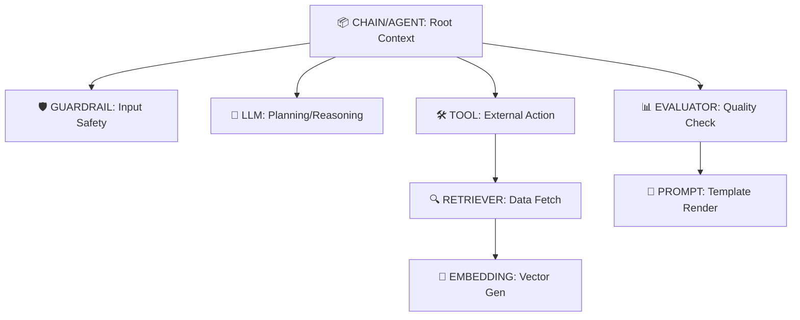

# Jet Telemetry: Complete Usage Guide & Philosophy

## 1. Core Philosophy: "Structure is Semantics"

`jet-telemetry` is designed to make observability **invisible** while ensuring **semantic richness**. It bridges the gap between raw OpenTelemetry and the specific needs of AI applications by enforcing a strict hierarchy that mirrors cognitive flow.

### The Golden Rules

1.  **Decorator-First:** Use decorators to wrap logic. This keeps business code clean and ensures consistent attribute capture.
2.  **Hierarchy Matters:** Every trace should have a root (`@chain` or `@agent`). Leaf nodes (`@llm`, `@tool`) must be nested under parents to show context.
3.  **Safety by Default:** PII (passwords, keys) is automatically redacted. Large vectors are never stored; only dimensions and metadata are captured.
4.  **Lazy Initialization:** Decorators can be applied at module load time without crashing if telemetry isn't initialized yet.

---

## 2. The Span Hierarchy Model

Your traces should follow this semantic tree to maximize debuggability in Arize Phoenix:



### Why Nesting Matters

- **Agent Loops:** An `@agent` span wraps the entire loop. Each iteration’s `@llm` (planning) and `@tool` (execution) become children. This allows you to visualize "thought processes" over time.
- **RAG Pipelines:** A `@retriever` span contains nested `@embedding` spans. If retrieval fails, you can drill down to see if it was an embedding error or a vector store timeout.
- **Tool Registry:** By consistently using `@tool(name="...")`, Phoenix aggregates all unique tool names. You can query: _"Show me all traces where `tool.name = 'get_weather'` failed."_

---

## 3. The Decorator Toolkit

### 🧠 Core AI Components

| Decorator | Span Kind | Use Case                               | Key Attributes Captured                                           |
| :-------- | :-------- | :------------------------------------- | :---------------------------------------------------------------- |
| `@llm`    | `LLM`     | Wraps calls to LLM providers.          | `llm.model_name`, `llm.input_messages` (redacted), `llm.provider` |
| `@tool`   | `TOOL`    | Wraps external actions (APIs, DBs).    | `tool.name`, `tool.description`, `tool.parameters`                |
| `@agent`  | `AGENT`   | Wraps autonomous agent loops.          | `agent.name`                                                      |
| `@chain`  | `CHAIN`   | Wraps orchestration logic (Root span). | Acts as the parent for all nested spans.                          |

### 🔍 RAG & Search Components

| Decorator    | Span Kind   | Use Case                              | Key Attributes Captured                                                           |
| :----------- | :---------- | :------------------------------------ | :-------------------------------------------------------------------------------- |
| `@embedding` | `EMBEDDING` | Wraps text-to-vector generation.      | `embedding.model_name`, `embedding.text` (redacted), `embedding.vector_dimension` |
| `@retriever` | `RETRIEVER` | Wraps vector store or keyword search. | `retriever.model_name`, `retrieval.query`, `retrieval.document_count`             |
| `@reranker`  | `RERANKER`  | Wraps re-scoring of documents.        | `reranker.model_name`, `reranker.query`, `reranker.output_document_count`         |

### 🛡️ Safety, Eval & Prompting

| Decorator    | Span Kind   | Use Case                           | Key Attributes Captured               |
| :----------- | :---------- | :--------------------------------- | :------------------------------------ |
| `@guardrail` | `GUARDRAIL` | Input/output safety checks.        | `guardrail.input`, `guardrail.result` |
| `@evaluator` | `EVALUATOR` | LLM-as-a-judge or scoring logic.   | Custom attributes via span.           |
| `@prompt`    | `PROMPT`    | Prompt templating/rendering steps. | Custom attributes via span.           |

---

## 4. Advanced Patterns

### A. Decorator Stacking (Composability)

You can stack multiple decorators to add cross-cutting concerns like performance monitoring, caching, or retry logic to a single span.

**Example: A Robust Tool**

```python
from jet_telemetry import tool, performance_monitor

# Custom decorators (defined in your app) can also be stacked
@tool(description="Search DB")
@performance_monitor(threshold_ms=200) # Adds perf.duration_ms attribute
@my_cache_decorator # Adds cache.hit attribute
@retry_with_tracking(max_retries=3) # Adds retry.attempts attribute
async def search_db(query: str):
    # Logic here
    pass
```

_Result:_ A single `TOOL` span in Phoenix that contains tool semantics, latency metrics, cache status, and retry history.

### B. Composite Decorators

For frequently used patterns, create a composite decorator to keep code clean.

```python
def fully_observed_llm(func=None, *, model_name: str = "llama-3"):
    def decorator(f):
        f = llm(model_name=model_name)(f)
        f = prompt_tracker(f) # Custom decorator
        f = performance_monitor(threshold_ms=1000)(f)
        return f
    if func is not None:
        return decorator(func)
    return decorator

@fully_observed_llm(model_name="llama-3.2")
async def smart_generate(prompt: str):
    # ...
```

### C. Streaming LLMs

The `@llm` decorator works seamlessly with streaming. It captures input messages before the stream starts.

```python
@llm(model_name="llama-3.2-3b-instruct")
async def chat(messages: list):
    stream = await client.chat.completions.create(..., stream=True)
    async for chunk in stream:
        yield chunk
```

### D. Hybrid Search (Retrieval + Reranking)

Use `@retriever` and `@reranker` as siblings or nested steps under a `@chain`.

```python
@chain(name="hybrid-search")
async def search(query: str):
    # 1. Semantic Retrieval
    docs = await vector_search(query)

    # 2. Lexical Reranking
    ranked = await bm25_rerank(query, docs)

    return ranked
```

---

## 5. Utilities & Helpers

### Trace Management

```python
from jet_telemetry import get_trace_url, export_spans_to_jsonl

# Get a clickable link to Phoenix UI
url = get_trace_url()

# Export spans to JSONL for offline analysis or CI/CD checks
export_spans_to_jsonl(
    project_name="my-app",
    trace_id="...", # Optional, defaults to current
    output_path="trace.jsonl"
)
```

### Security & Hashing

- **Redaction:** Automatic for fields containing "password", "ssn", "api_key", etc.
- **Hashing:** Use `hash_prompt()` to create a unique ID for a prompt template without storing the full text.

```python
from jet_telemetry import hash_prompt, redact

prompt_hash = hash_prompt("Hello {name}") # Returns short hex string
safe_text = redact("My password is 1234") # Returns "[REDACTED...]"
```

### Manual Attribute Injection

If a decorator doesn't capture something specific, use OpenTelemetry directly on the current span.

```python
from opentelemetry import trace as otel_trace

@tool(name="weather")
async def get_weather(city: str):
    span = otel_trace.get_current_span()
    if span.is_recording():
        span.set_attribute("custom.city_code", "TYO")
    # ... logic
```

---

## 6. Getting Started

### Installation

```bash
pip install jet-telemetry
```

### Initialization

Always initialize telemetry at the entry point of your application.

```python
from jet_telemetry import initialize_telemetry

initialize_telemetry(
    service_name="my-ai-app",
    endpoint="http://localhost:6006" # Default Phoenix URL
)
```

---

## 7. Troubleshooting & Best Practices

1.  **Flat Traces:** Always wrap your main logic in a `@chain` or `@agent`. Without a root, spans may appear disconnected.
2.  **Missing Attributes:** Ensure you pass arguments (like `messages` for `@llm`) in a way the decorator can inspect.
3.  **Async Context:** Use `async def` and `await` inside decorated functions. The decorators handle async context propagation automatically.
4.  **Error Handling:** Let exceptions propagate. The decorators will record the exception on the span, making debugging easier.
5.  **Large Payloads:** Never pass raw images or massive JSON blobs as arguments to decorated functions if they contain PII. Use references/IDs instead.

### Summary Checklist for LLMs

When generating code with `jet-telemetry`, ensure:

- [ ] There is a root `@chain` or `@agent`.
- [ ] All LLM calls are wrapped in `@llm` with `model_name`.
- [ ] All external actions are wrapped in `@tool` with `name` and `description`.
- [ ] RAG steps are properly nested (`@retriever` -> `@embedding`).
- [ ] Sensitive data is handled via `redact()` or automatic PII filtering.
