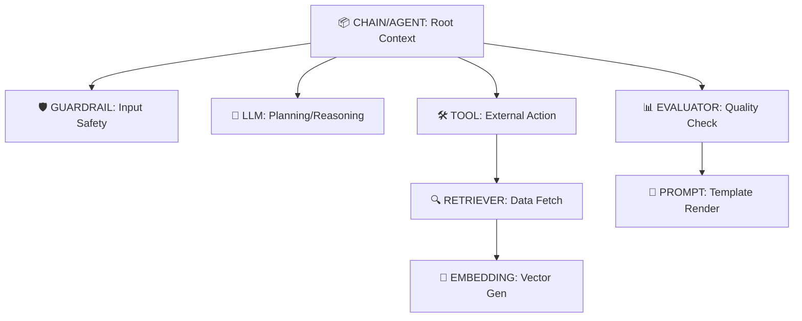

# Jet Telemetry: Complete Usage Guide & Philosophy

## 1. Core Philosophy: "Structure is Semantics"

`jet-telemetry` makes observability **invisible** while ensuring **semantic richness**. It enforces a strict hierarchy that mirrors cognitive flow.

### The Golden Rules

1.  **Decorator-First:** Wrap logic to enforce consistent attribute capture.
2.  **Hierarchy Matters:** Every trace must have a root (`@chain` or `@agent`). Leaf nodes (`@llm`, `@tool`) must be nested under parents.
3.  **Safety by Default:** PII (passwords, keys) is auto-redacted. Large vectors are never stored; only dimensions are captured.
4.  **Lazy Initialization:** Decorators can be applied at module load time without crashing if telemetry isn't initialized yet.

---

## 2. The Span Hierarchy Model

Your traces should follow this semantic tree to maximize debuggability in Arize Phoenix:



### Why Nesting Matters

- **Agent Loops:** An `@agent` span wraps the entire loop. Each iteration’s `@llm` (planning) and `@tool` (execution) become children, visualizing "thought processes."
- **RAG Pipelines:** A `@retriever` span contains nested `@embedding` spans. If retrieval fails, you can drill down to see if it was an embedding error or a vector store timeout.
- **Tool Registry:** By consistently using `@tool(name="...")`, Phoenix aggregates all unique tool names for querying failures.

---

## 3. The Decorator Toolkit & Attributes

Every decorator captures specific **OpenInference** attributes.

| Decorator    | Span Kind   | Input Value (`INPUT_VALUE`) | Output Value (`OUTPUT_VALUE`)  | Key Semantic Attributes                                                     |
| :----------- | :---------- | :-------------------------- | :----------------------------- | :-------------------------------------------------------------------------- |
| `@llm`       | `LLM`       | JSON: `[{role, content}]`   | JSON: `[{role, content}]`      | `llm.model_name`, `llm.token_count.*`, `llm.provider`, `llm.input_messages` |
| `@tool`      | `TOOL`      | JSON: `{params}`            | Text/JSON: Result              | `tool.name`, `tool.description`, `tool.parameters`                          |
| `@agent`     | `AGENT`     | Text: User Query            | Text: Final Answer             | `agent.name`, `session.id`                                                  |
| `@chain`     | `CHAIN`     | Text/JSON: Input            | Text/JSON: Output              | `session.id` (if provided)                                                  |
| `@retriever` | `RETRIEVER` | Text: Query                 | JSON: `[{id, score, content}]` | `retrieval.documents`, `retrieval.document_count`                           |
| `@embedding` | `EMBEDDING` | Text: Input String          | N/A (Dimension only)           | `embedding.model_name`, `embedding.vector_dimension`                        |
| `@guardrail` | `GUARDRAIL` | Text: Content               | Text: Pass/Fail                | `guardrail.input`, `guardrail.result`                                       |
| `@evaluator` | `EVALUATOR` | Text/JSON: Data             | Text: Score/Reason             | `evaluations`                                                               |
| `@prompt`    | `PROMPT`    | N/A                         | Text: Rendered Prompt          | `prompt.template`, `prompt.variables`                                       |

---

## 4. Advanced Patterns

### A. Agentic Workflows & Session Tracking

Use `session_id` to group multi-turn traces in Phoenix.

```python
from jet_telemetry import agent, llm

@agent(name="support_bot", session_id="user_123_session_456")
async def handle_message(query: str):
    # All spans inside this agent will share the same session.id
    response = await generate_response(query)
    return response
```

### B. Decorator Stacking (Composability)

Stack decorators to add cross-cutting concerns like performance monitoring.

```python
from jet_telemetry import tool, performance_monitor

@tool(description="Search DB")
@performance_monitor(threshold_ms=200) # Adds perf.duration_ms attribute
async def search_db(query: str):
    pass
```

### C. Gold Standard Example: RAG-Agent Flow

A complete flow demonstrating proper nesting, attribute capture, and session tracking.

```python
from jet_telemetry import initialize_telemetry, agent, llm, retriever, tool, chain, guardrail, evaluator

initialize_telemetry(service_name="rag-agent")

@chain(name="rag-pipeline", session_id="session_1")
async def rag_pipeline(query: str):
    # 1. Guardrail
    safe_query = await check_safety(query)

    # 2. Retrieval
    docs = await retrieve_docs(safe_query)

    # 3. LLM Generation
    response = await generate_answer(safe_query, docs)

    # 4. Evaluation
    score = await evaluate_faithfulness(response, docs)

    return response

@guardrail(name="input-check")
async def check_safety(text: str):
    return "PASS"

@retriever(model_name="vector-store-v1")
async def retrieve_docs(query: str):
    # Returns list of dicts with 'id', 'score', 'content'
    return [{"id": "1", "score": 0.9, "content": "Jet Telemetry is great"}]

@llm(model_name="gpt-4o", provider="openai")
async def generate_answer(query: str, docs: list):
    # Expects 'messages' argument for auto-capture
    messages = [{"role": "user", "content": f"{query}\nContext: {docs}"}]
    # Mock response object for demonstration
    class MockResult:
        choices = [type('obj', (object,), {'message': type('obj', (object,), {'role': 'assistant', 'content': 'Yes it is.'})})]
        usage = type('obj', (object,), {'prompt_tokens': 10, 'completion_tokens': 5, 'total_tokens': 15})
    return MockResult()

@evaluator(name="faithfulness-check")
async def evaluate_faithfulness(response: str, docs: list):
    return {"score": 0.95, "reason": "Grounded in context"}
```

---

## 5. Utilities & Helpers

### Trace Management

```python
from jet_telemetry import get_trace_url, export_spans_to_jsonl

# Get a clickable link to Phoenix UI
url = get_trace_url()

# Export spans to JSONL for offline analysis or CI/CD checks
export_spans_to_jsonl(
    project_name="my-app",
    trace_id="...", # Optional, defaults to current
    output_path="trace.jsonl"
)
```

### Security & Hashing

- **Redaction:** Automatic for fields containing "password", "ssn", "api_key", etc.
- **Hashing:** Use `hash_prompt()` to create a unique ID for a prompt template without storing the full text.

```python
from jet_telemetry import hash_prompt, redact

prompt_hash = hash_prompt("Hello {name}") # Returns short hex string
safe_text = redact("My password is 1234") # Returns "[REDACTED...]"
```

### Manual Attribute Injection

If a decorator doesn't capture something specific, use OpenTelemetry directly on the current span.

```python
from opentelemetry import trace as otel_trace

@tool(name="weather")
async def get_weather(city: str):
    span = otel_trace.get_current_span()
    if span.is_recording():
        span.set_attribute("custom.city_code", "TYO")
    # ... logic
```

---

## 6. Getting Started

### Installation

```bash
pip install jet-telemetry
```

### Initialization

Always initialize telemetry at the entry point of your application.

```python
from jet_telemetry import initialize_telemetry

initialize_telemetry(
    service_name="my-ai-app",
    endpoint="http://localhost:6006" # Default Phoenix URL
)
```

---

## 7. Troubleshooting & Best Practices

1.  **Flat Traces:** Always wrap your main logic in a `@chain` or `@agent`. Without a root, spans may appear disconnected.
2.  **Missing Attributes:** Ensure you pass arguments (like `messages` for `@llm`) in a way the decorator can inspect.
3.  **Async Context:** Use `async def` and `await` inside decorated functions. The decorators handle async context propagation automatically.
4.  **Error Handling:** Let exceptions propagate. The decorators will record the exception on the span, making debugging easier.
5.  **Large Payloads:** Never pass raw images or massive JSON blobs as arguments to decorated functions if they contain PII. Use references/IDs instead.

### Summary Checklist for LLMs

When generating code with `jet-telemetry`, ensure:

- [ ] There is a root `@chain` or `@agent`.
- [ ] All LLM calls are wrapped in `@llm` with `model_name`.
- [ ] All external actions are wrapped in `@tool` with `name` and `description`.
- [ ] RAG steps are properly nested (`@retriever` -> `@embedding`).
- [ ] Sensitive data is handled via `redact()` or automatic PII filtering.
- [ ] `session_id` is used for multi-turn conversations.
