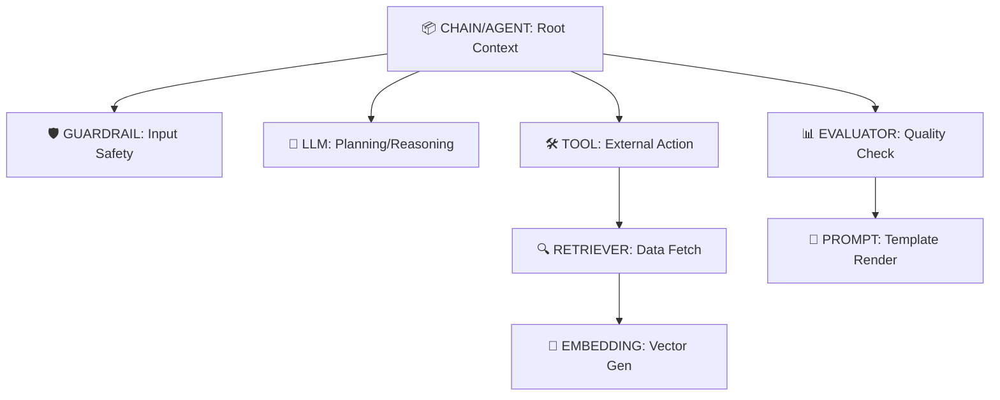

# Jet Telemetry: Complete Usage Guide & Philosophy

## 1. Core Philosophy: "Structure is Semantics"

`jet-telemetry` makes observability **invisible** while ensuring **semantic richness**. It enforces a strict hierarchy that mirrors cognitive flow.

### The Golden Rules

1.  **Decorator-First:** Wrap logic to enforce consistent attribute capture.
2.  **Hierarchy Matters:** Every trace must have a root (`@chain` or `@agent`). Leaf nodes (`@llm`, `@tool`) must be nested under parents.
3.  **Safety by Default:** PII (passwords, keys) is auto-redacted. Large vectors are never stored; only dimensions are captured.
4.  **Lazy Initialization:** Decorators can be applied at module load time without crashing if telemetry isn't initialized yet.

---

## 2. The Span Hierarchy Model

Your traces should follow this semantic tree to maximize debuggability in Arize Phoenix:



### Why Nesting Matters

- **Agent Loops:** An `@agent` span wraps the entire loop. Each iteration's `@llm` (planning) and `@tool` (execution) become children, visualizing "thought processes."
- **RAG Pipelines:** A `@retriever` span contains nested `@embedding` spans. If retrieval fails, you can drill down to see if it was an embedding error or a vector store timeout.
- **Tool Registry:** By consistently using `@tool(name="...")`, Phoenix aggregates all unique tool names for querying failures.

### Understanding Automatic Nesting

Spans automatically nest based on **execution context**, not decorator placement. When a decorated function calls another decorated function, OpenTelemetry creates a parent-child relationship.

#### ❌ Incorrect: Flat Structure (All decorators at module level)

```python
# These are siblings, not parent-child!
@chain(name="main-flow")
async def main_flow(query: str):
    result = await step_one(query)  # step_one is NOT decorated
    return result

@llm(model_name="gpt-4")
async def step_one(query: str):  # This becomes a sibling span, not child
    return await call_llm(query)
```

#### ✅ Correct: Nested Execution (Parent calls decorated children)

```python
@chain(name="rag-pipeline", session_id="session_123")
async def rag_pipeline(query: str):
    """Root span: All decorated functions called inside become children."""

    # Step 1: Safety check (child span)
    safe_query = await check_safety(query)

    # Step 2: Retrieval (child span with its own children)
    docs = await retrieve_docs(safe_query)

    # Step 3: Generation (child span)
    response = await generate_answer(safe_query, docs)

    return response

@guardrail(name="input-safety")
async def check_safety(text: str):
    """Child span of rag_pipeline"""
    if "password" in text.lower():
        return "[REDACTED]"
    return text

@retriever(model_name="vector-store-v1")
async def retrieve_docs(query: str):
    """Child span of rag_pipeline. May contain nested @embedding spans."""
    # Simulate vector search
    embeddings = await get_embeddings(query)  # Another child span
    return [{"id": "doc1", "score": 0.95, "content": "Relevant content"}]

@embedding(model_name="text-embedding-3-small")
async def get_embeddings(text: str):
    """Grandchild span: nested under retrieve_docs"""
    return [0.1, 0.2, 0.3, ...]  # 1536-dim vector

@llm(model_name="gpt-4o", provider="openai")
async def generate_answer(query: str, docs: list):
    """Child span of rag_pipeline"""
    messages = [{"role": "user", "content": f"{query}\nContext: {docs}"}]
    # LLM call happens here
    return {"role": "assistant", "content": "Answer based on context"}
```

**Key Insight:** The span hierarchy is determined by **runtime call stack**, not file structure. Always call decorated functions from within a parent decorated function.

---

## 3. The Decorator Toolkit & Attributes

Every decorator captures specific **OpenInference** attributes. Understanding what's auto-captured vs what you must provide is critical.

### Attribute Capture Matrix

| Decorator    | Span Kind   | Input Value<br/>(Auto-Captured)       | Output Value<br/>(Auto-Captured)         | User-Provided<br/>(Via Params)         | Manual Injection<br/>(Via span.set_attribute) | Required?     |
| :----------- | :---------- | :------------------------------------ | :--------------------------------------- | :------------------------------------- | :-------------------------------------------- | :------------ |
| `@llm`       | `LLM`       | `messages` arg → `llm.input_messages` | Response → `llm.output_messages`         | `model_name`, `provider`, `session_id` | Cost, custom metadata                         | ✅ model_name |
| `@tool`      | `TOOL`      | kwargs → `tool.parameters`            | Return value → `output.value`            | `name`, `description`                  | Custom tool metadata                          | ✅ name       |
| `@agent`     | `AGENT`     | First arg → `input.value`             | Return value → `output.value`            | `name`, `session_id`                   | Decision steps, iteration count               | ✅ name       |
| `@chain`     | `CHAIN`     | N/A                                   | N/A                                      | `name`, `session_id`                   | Pipeline stage markers                        | ✅ name       |
| `@retriever` | `RETRIEVER` | First arg → `input.value`             | List → `retrieval.documents`             | `model_name`                           | Filter criteria, index name                   | Optional      |
| `@embedding` | `EMBEDDING` | First arg → `input.value`             | Dimension → `embedding.vector_dimension` | `model_name`                           | Batch size, normalization method              | ✅ model_name |
| `@guardrail` | `GUARDRAIL` | First arg → `input.value`             | Return value → `output.value`            | `name`                                 | Policy version, threshold                     | ✅ name       |
| `@evaluator` | `EVALUATOR` | N/A                                   | Return value → `output.value`            | `name`                                 | Evaluation criteria, rubric                   | ✅ name       |
| `@prompt`    | `PROMPT`    | N/A                                   | Return value → `output.value`            | `name`                                 | Template hash, variable values                | Optional      |

### Detailed Attribute Examples

#### `@llm` - Complete Attribute Set

```python
@llm(
    model_name="gpt-4o",           # ✅ Required: Sets llm.model_name
    provider="openai",             # ✅ Recommended: Sets llm.provider
    session_id="user_123"          # ✅ For multi-turn: Sets session.id
)
async def chat(messages: list):
    """
    Auto-captured attributes:
    - llm.input_messages: JSON from 'messages' arg
    - llm.output_messages: JSON from response.choices[0].message
    - llm.token_count.prompt: From response.usage.prompt_tokens
    - llm.token_count.completion: From response.usage.completion_tokens
    - llm.token_count.total: From response.usage.total_tokens
    - input.mime_type: "application/json"
    - output.mime_type: "application/json"

    Manual injection example:
    """
    response = await openai_client.chat.completions.create(...)

    # Add cost information (not auto-captured)
    span = otel_trace.get_current_span()
    if span.is_recording():
        span.set_attribute("llm.cost.total", 0.002)
        span.set_attribute("llm.cost.prompt", 0.001)
        span.set_attribute("llm.cost.completion", 0.001)

    return response
```

#### `@tool` - Complete Attribute Set

```python
@tool(
    name="search_database",        # ✅ Required: Sets tool.name
    description="Searches product database"  # ✅ Recommended: Sets tool.description
)
async def search_db(query: str, limit: int = 10):
    """
    Auto-captured attributes:
    - tool.parameters: JSON from kwargs {"query": "...", "limit": 10}
    - output.value: String representation of return value
    - output.mime_type: "text/plain"

    Note: Only keyword arguments are captured as tool.parameters.
    Positional args are NOT captured automatically.
    """
    results = await db.search(query, limit=limit)
    return results  # Converted to string via str()
```

#### `@retriever` - Complete Attribute Set

```python
@retriever(
    model_name="pinecone-index-v2"  # ✅ Sets retriever.model_name
)
async def retrieve(query: str):
    """
    Auto-captured attributes:
    - input.value: First positional arg (query string)
    - input.mime_type: "text/plain"
    - retrieval.documents: JSON array of top 10 docs with id, score, content
    - retrieval.document_count: Total number of documents returned

    Expected return format for optimal capture:
    """
    docs = [
        {"id": "doc_1", "score": 0.95, "content": "Content truncated to 500 chars"},
        {"id": "doc_2", "score": 0.87, "content": "Another document..."}
    ]
    return docs  # Must be list of dicts or strings
```

#### `@embedding` - Complete Attribute Set

```python
@embedding(
    model_name="text-embedding-3-small"  # ✅ Required: Sets embedding.model_name
)
async def embed(text: str):
    """
    Auto-captured attributes:
    - input.value: First positional arg (text string)
    - input.mime_type: "text/plain"
    - embedding.text_length: Length of input text
    - embedding.vector_dimension: Length of output vector (if list or np.ndarray)

    Note: Actual vector values are NEVER stored (too large).
    Only the dimension is captured.
    """
    import numpy as np
    vector = np.random.rand(1536)  # 1536-dimensional embedding
    return vector  # dimension=1536 will be captured
```

---

## 4. Span Completeness Guide

### When to Create a New Span

Use this decision framework:

```
Is this a distinct logical operation?
├─ YES → Does it involve external I/O or significant computation?
│         ├─ YES → Create a span with appropriate decorator
│         └─ NO → Is it a key business event?
│                  ├─ YES → Create a span with @trace(kind="...")
│                  └─ NO → Just add an attribute to parent span
└─ NO → Add as attribute to current span
```

#### ✅ Create a Span For:

1. **External API Calls**: LLM requests, database queries, HTTP calls
2. **Data Transformations**: Embedding generation, reranking, filtering
3. **Decision Points**: Guardrail checks, routing logic, agent iterations
4. **Quality Checks**: Evaluation, validation, scoring
5. **User-Facing Operations**: Prompt rendering, response formatting

#### ❌ Don't Create a Span For:

1. Simple variable assignments
2. Logging statements
3. Minor data formatting (unless it's a key business event)
4. Internal state updates

### Handling Key Events as Spans

#### Error Handling Patterns

```python
@chain(name="robust-pipeline")
async def robust_pipeline(query: str):
    """Demonstrates error handling with spans."""

    try:
        # Each step is a child span that records exceptions
        docs = await retrieve_with_fallback(query)
        response = await generate_with_retry(docs)
        return response
    except Exception as e:
        # Exception is automatically recorded on the chain span
        raise  # Let it propagate; don't swallow errors

@retriever(model_name="primary-index")
async def retrieve_primary(query: str):
    """May fail - exception recorded on this span."""
    return await vector_db.search(query)

@retriever(model_name="fallback-index")
async def retrieve_fallback(query: str):
    """Fallback if primary fails."""
    return await backup_db.search(query)

@chain(name="retrieve-with-fallback")
async def retrieve_with_fallback(query: str):
    """Wrapper that tries primary, then fallback."""
    try:
        return await retrieve_primary(query)
    except Exception:
        # Both retrieve_primary and retrieve_fallback spans exist in trace
        return await retrieve_fallback(query)

@llm(model_name="gpt-4o", provider="openai")
async def generate_with_retry(docs: list, max_retries: int = 3):
    """Shows retry logic as repeated attempts."""
    for attempt in range(max_retries):
        try:
            return await call_llm(docs)
        except Exception as e:
            if attempt == max_retries - 1:
                raise
            # Each failed attempt creates a span with exception recorded
            await asyncio.sleep(2 ** attempt)  # Exponential backoff
```

#### Conditional Branching

```python
@agent(name="smart-router", session_id="session_1")
async def route_query(query: str):
    """Agent decides which path to take."""

    # Classification step (always happens)
    intent = await classify_intent(query)

    # Conditional branches (only one executes, but span exists)
    if intent == "factual":
        return await factual_path(query)
    elif intent == "creative":
        return await creative_path(query)
    else:
        return await default_path(query)

@chain(name="factual-path")
async def factual_path(query: str):
    """Only executed for factual queries."""
    docs = await retrieve_docs(query)
    return await generate_answer(query, docs)

@chain(name="creative-path")
async def creative_path(query: str):
    """Only executed for creative queries."""
    return await generate_creative(query)
```

### Lifecycle Events as Spans

For long-running processes, mark key lifecycle events:

```python
@chain(name="batch-processing")
async def process_batch(items: list):
    """Process multiple items with lifecycle tracking."""

    total = len(items)
    successful = 0

    for i, item in enumerate(items):
        # Each item gets its own span
        result = await process_item(item, index=i, total=total)
        if result.success:
            successful += 1

    # Final summary attribute on parent span
    span = otel_trace.get_current_span()
    if span.is_recording():
        span.set_attribute("batch.total", total)
        span.set_attribute("batch.successful", successful)
        span.set_attribute("batch.failure_rate", (total - successful) / total)

    return {"total": total, "successful": successful}

@tool(name="process-single-item")
async def process_item(item: dict, index: int, total: int):
    """Each item processing is a child span."""
    # Processing logic
    return {"success": True, "item_id": item["id"]}
```

---

## 5. Attribute Validation & Testing

### Completeness Checklist

Before deploying, verify each span type has required attributes:

#### `@llm` Span Checklist

- [ ] `llm.model_name` is set (via decorator param)
- [ ] `llm.provider` is set (via decorator param)
- [ ] `llm.input_messages` exists (pass `messages` arg as list of dicts)
- [ ] `llm.output_messages` exists (return object with `.choices[0].message`)
- [ ] `llm.token_count.*` exists (return object with `.usage` attribute)
- [ ] `session.id` is set if multi-turn (via decorator param)

#### `@tool` Span Checklist

- [ ] `tool.name` is set (via decorator param)
- [ ] `tool.description` is set (via decorator param)
- [ ] `tool.parameters` exists (pass kwargs, not just positional args)
- [ ] `output.value` exists (function returns something)

#### `@retriever` Span Checklist

- [ ] `retrieval.documents` exists (return list of dicts with id/score/content)
- [ ] `retrieval.document_count` exists (automatically calculated)
- [ ] `input.value` exists (first positional arg is query string)

#### `@embedding` Span Checklist

- [ ] `embedding.model_name` is set (via decorator param)
- [ ] `embedding.vector_dimension` exists (return list or np.ndarray)
- [ ] `input.value` exists (first positional arg is text)

### Programmatic Validation Example

```python
from jet_telemetry import initialize_telemetry, export_spans_to_jsonl
import json

# After running your traced code
initialize_telemetry(service_name="validation-test")

# Export spans for inspection
export_spans_to_jsonl(
    project_name="validation-test",
    output_path="spans.jsonl"
)

# Validate span completeness
with open("spans.jsonl") as f:
    spans = [json.loads(line) for line in f]

for span in spans:
    kind = span.get("attributes", {}).get("openinference.span.kind")
    attrs = span.get("attributes", {})

    print(f"\nSpan: {span['name']} (Kind: {kind})")

    if kind == "LLM":
        required = ["llm.model_name", "llm.input_messages", "llm.output_messages"]
        for attr in required:
            status = "✅" if attr in attrs else "❌"
            print(f"  {status} {attr}")

    elif kind == "TOOL":
        required = ["tool.name", "tool.parameters"]
        for attr in required:
            status = "✅" if attr in attrs else "❌"
            print(f"  {status} {attr}")
```

### Common Pitfalls & Solutions

#### Pitfall 1: Missing Input Capture

```python
# ❌ BAD: Positional args not captured for @tool
@tool(name="search")
async def search(query):  # 'query' is positional, won't be in tool.parameters
    return await db.search(query)

# ✅ GOOD: Use kwargs or ensure first arg is captured
@tool(name="search")
async def search(query: str):  # First positional arg → input.value
    return await db.search(query)

# ✅ ALSO GOOD: Explicit kwargs
@tool(name="search")
async def search(**kwargs):  # kwargs → tool.parameters
    query = kwargs.get("query")
    return await db.search(query)
```

#### Pitfall 2: Incomplete LLM Response Object

```python
# ❌ BAD: Custom response object missing required structure
@llm(model_name="gpt-4")
async def chat(messages: list):
    response = {"text": "Hello"}  # Won't capture output_messages or tokens
    return response

# ✅ GOOD: Match expected structure
@llm(model_name="gpt-4")
async def chat(messages: list):
    class MockMessage:
        role = "assistant"
        content = "Hello"

    class MockChoice:
        message = MockMessage()

    class MockUsage:
        prompt_tokens = 10
        completion_tokens = 5
        total_tokens = 15

    class MockResponse:
        choices = [MockChoice()]
        usage = MockUsage()

    return MockResponse()  # Properly captures messages and tokens
```

#### Pitfall 3: Flat Trace Structure

```python
# ❌ BAD: All decorators at same level, no nesting
@chain(name="pipeline")
async def pipeline(query: str):
    return await step_one(query)  # step_one not decorated

@llm(model_name="gpt-4")
async def step_one(query: str):  # Becomes sibling, not child!
    return "response"

# ✅ GOOD: Call decorated functions from within parent
@chain(name="pipeline")
async def pipeline(query: str):
    return await step_one(query)  # step_one becomes child span

@llm(model_name="gpt-4")
async def step_one(query: str):  # Properly nested under pipeline
    return "response"
```

#### Pitfall 4: Large Payloads in Attributes

```python
# ❌ BAD: Passing huge vectors or images
@embedding(model_name="embedder")
async def embed(image_bytes: bytes):  # Will try to store massive data
    return vector

# ✅ GOOD: Pass references, not raw data
@embedding(model_name="embedder")
async def embed(image_id: str):  # Just the ID
    image_bytes = load_from_storage(image_id)  # Load internally
    vector = compute_embedding(image_bytes)
    return vector
```

---

## 6. Advanced Patterns

### A. Agentic Workflows & Session Tracking

Use `session_id` to group multi-turn traces in Phoenix.

```python
from jet_telemetry import agent, llm

@agent(name="support_bot", session_id="user_123_session_456")
async def handle_message(query: str):
    # All spans inside this agent will share the same session.id
    response = await generate_response(query)
    return response
```

### B. Decorator Stacking (Composability)

Stack decorators to add cross-cutting concerns like performance monitoring.

```python
from jet_telemetry import tool, performance_monitor

@tool(description="Search DB")
@performance_monitor(threshold_ms=200)  # Adds perf.duration_ms attribute
async def search_db(query: str):
    pass
```

### C. Gold Standard Example: Complete RAG-Agent Flow

A production-ready example demonstrating proper nesting, complete attributes, error handling, and session tracking.

```python
from jet_telemetry import (
    initialize_telemetry,
    agent, llm, retriever, tool, chain,
    guardrail, evaluator, embedding
)
import asyncio

# Initialize at application entry point
initialize_telemetry(service_name="production-rag-agent")

@agent(name="rag-agent", session_id="user_abc_123")
async def handle_user_query(query: str) -> dict:
    """
    Root agent span. Handles multi-turn conversation with full tracing.

    Span hierarchy:
    - rag-agent (AGENT)
      ├── input-safety (GUARDRAIL)
      ├── retrieve-context (CHAIN)
      │   ├── vector-search (RETRIEVER)
      │   │   └── compute-query-embedding (EMBEDDING)
      │   └── rerank-results (RERANKER)
      ├── generate-response (CHAIN)
      │   ├── render-prompt (PROMPT)
      │   └── call-llm (LLM)
      └── evaluate-quality (EVALUATOR)
    """

    # Step 1: Safety check
    safe_query = await check_input_safety(query)

    # Step 2: Retrieve relevant context
    context_docs = await retrieve_context(safe_query)

    # Step 3: Generate response with context
    response = await generate_answer(safe_query, context_docs)

    # Step 4: Evaluate response quality
    quality_score = await evaluate_response(response, context_docs)

    return {
        "response": response,
        "quality_score": quality_score,
        "context_count": len(context_docs)
    }

@guardrail(name="input-safety")
async def check_input_safety(text: str) -> str:
    """Validates input for PII and harmful content."""
    if any(word in text.lower() for word in ["password", "ssn", "credit card"]):
        return "[REDACTED: Contains sensitive information]"
    return text

@chain(name="retrieve-context")
async def retrieve_context(query: str) -> list:
    """Orchestrates retrieval pipeline with embedding and reranking."""

    # Get query embedding
    query_vector = await compute_query_embedding(query)

    # Search vector database
    raw_docs = await vector_search(query_vector, top_k=20)

    # Rerank for better relevance
    ranked_docs = await rerank_results(query, raw_docs)

    return ranked_docs[:5]  # Return top 5

@embedding(model_name="text-embedding-3-small")
async def compute_query_embedding(text: str) -> list:
    """Generates embedding for search query."""
    # In real implementation, call embedding API
    # Returns 1536-dimensional vector
    return [0.1] * 1536

@retriever(model_name="pinecone-production")
async def vector_search(query_vector: list, top_k: int = 20) -> list:
    """Searches vector database for similar documents."""
    # Simulated vector search
    return [
        {
            "id": f"doc_{i}",
            "score": 0.95 - (i * 0.02),
            "content": f"Relevant document content {i}. " * 10
        }
        for i in range(top_k)
    ]

@reranker(model_name="cross-encoder-v1")
async def rerank_results(query: str, documents: list) -> list:
    """Reranks documents based on query relevance."""
    # Simulated reranking (sorts by score)
    return sorted(documents, key=lambda x: x["score"], reverse=True)

@chain(name="generate-response")
async def generate_answer(query: str, context: list) -> str:
    """Orchestrates prompt rendering and LLM call."""

    # Render prompt template
    prompt = await render_prompt(query, context)

    # Call LLM with rendered prompt
    messages = [{"role": "user", "content": prompt}]
    response = await call_llm(messages)

    return response

@prompt(name="rag-template")
async def render_prompt(query: str, context: list) -> str:
    """Renders prompt template with context."""
    context_text = "\n".join([doc["content"] for doc in context])
    return f"""Answer the question based on the context below.

Context:
{context_text}

Question: {query}

Answer:"""

@llm(model_name="gpt-4o", provider="openai")
async def call_llm(messages: list) -> str:
    """Calls LLM with proper message format for auto-capture."""
    # In production, this would call OpenAI API
    # For demo, return mock response with proper structure

    class Message:
        def __init__(self, role: str, content: str):
            self.role = role
            self.content = content

    class Choice:
        def __init__(self, message: Message):
            self.message = message

    class Usage:
        def __init__(self):
            self.prompt_tokens = 150
            self.completion_tokens = 50
            self.total_tokens = 200

    class Response:
        def __init__(self):
            self.choices = [Choice(Message("assistant", "Based on the context, the answer is..."))]
            self.usage = Usage()

    return Response()

@evaluator(name="faithfulness-evaluator")
async def evaluate_response(response: str, context: list) -> float:
    """Evaluates response faithfulness to context."""
    # Simulated evaluation
    return 0.92

# Usage
async def main():
    result = await handle_user_query("What is Jet Telemetry?")
    print(f"Response: {result['response']}")
    print(f"Quality: {result['quality_score']}")

if __name__ == "__main__":
    asyncio.run(main())
```

---

## 7. Utilities & Helpers

### Trace Management

```python
from jet_telemetry import get_trace_url, export_spans_to_jsonl

# Get a clickable link to Phoenix UI
url = get_trace_url()
print(f"View trace: {url}")

# Export spans to JSONL for offline analysis or CI/CD checks
export_spans_to_jsonl(
    project_name="my-app",
    trace_id="...",  # Optional, defaults to current
    output_path="trace.jsonl"
)
```

### Security & Hashing

- **Redaction:** Automatic for fields containing "password", "ssn", "api_key", etc.
- **Hashing:** Use `hash_prompt()` to create a unique ID for a prompt template without storing the full text.

```python
from jet_telemetry import hash_prompt, redact

prompt_hash = hash_prompt("Hello {name}")  # Returns short hex string
safe_text = redact("My password is 1234")  # Returns "[REDACTED...]"
```

### Manual Attribute Injection

If a decorator doesn't capture something specific, use OpenTelemetry directly on the current span.

```python
from opentelemetry import trace as otel_trace

@tool(name="weather")
async def get_weather(city: str):
    span = otel_trace.get_current_span()
    if span.is_recording():
        span.set_attribute("custom.city_code", "TYO")
        span.set_attribute("custom.api_version", "v2")
    # ... logic
```

---

## 8. Getting Started

### Installation

```bash
pip install jet-telemetry
```

### Initialization

Always initialize telemetry at the entry point of your application.

```python
from jet_telemetry import initialize_telemetry

initialize_telemetry(
    service_name="my-ai-app",
    endpoint="http://localhost:6006"  # Default Phoenix URL
)
```

---

## 9. Troubleshooting & Best Practices

1.  **Flat Traces:** Always wrap your main logic in a `@chain` or `@agent`. Without a root, spans may appear disconnected.
2.  **Missing Attributes:** Ensure you pass arguments (like `messages` for `@llm`) in a way the decorator can inspect.
3.  **Async Context:** Use `async def` and `await` inside decorated functions. The decorators handle async context propagation automatically.
4.  **Error Handling:** Let exceptions propagate. The decorators will record the exception on the span, making debugging easier.
5.  **Large Payloads:** Never pass raw images or massive JSON blobs as arguments to decorated functions if they contain PII. Use references/IDs instead.

### Summary Checklist for LLMs

When generating code with `jet-telemetry`, ensure:

- [ ] There is a root `@chain` or `@agent`.
- [ ] All LLM calls are wrapped in `@llm` with `model_name`.
- [ ] All external actions are wrapped in `@tool` with `name` and `description`.
- [ ] RAG steps are properly nested (`@retriever` → `@embedding`).
- [ ] Sensitive data is handled via `redact()` or automatic PII filtering.
- [ ] `session_id` is used for multi-turn conversations.
- [ ] Decorated functions are called from within parent decorated functions (not at module level).
- [ ] Return objects match expected structures (e.g., LLM responses have `.choices` and `.usage`).
- [ ] Each span kind has its required attributes (see Section 5 checklist).
- [ ] Errors are allowed to propagate for automatic exception recording.
